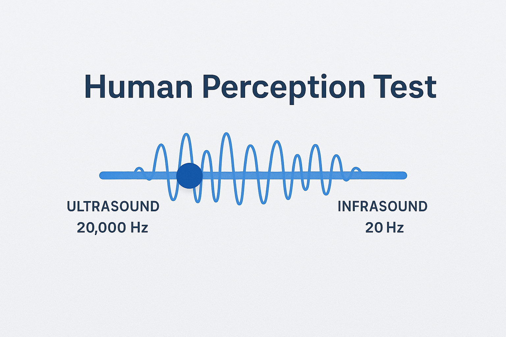

  

# Test de Perception Humaine

> ⚠️ Fabriqué en partie par l'IA !

## Lien : [https://bit.ly/SensTest](https://bit.ly/SensTest)

Un seul fichier `index.html`, sans dépendance ni build : il suffit de l'ouvrir ou de l'héberger (GitHub Pages).

### Fonctionnalités
- **Audition** : générateur de son (20 Hz – 20 kHz, 4 formes d'onde, nom de la note), volume à courbe perceptive, oscilloscope, et test automatique des limites aiguë et grave.
- **Vision** : test de fusion du clignotement (manuel ou automatique), limité correctement à la moitié de la fréquence de l'écran, avec avertissement photosensibilité.
- **Écran** : mesure fiable de la fréquence de rafraîchissement (médiane des intervalles d'images), définition et densité de pixels.
- **Réseau** : vrai test de latence, gigue, réception et envoi via les serveurs Cloudflare (multi-connexions, exclusion de la montée en charge TCP).
- **Résultats** enregistrés localement, copiables/partageables. Thème clair/sombre, responsive, touche Échap pour tout arrêter.

### Versions
**V1.0.1 :** Lancement  
**V1.1 :** Contrôles améliorés  
**V1.2 :** Amélioration de l'interface  
**V1.3 :** Amélioration globale de l'expérience utilisateur  
**V2.0 :** Refonte complète : test réseau réel (Cloudflare), tests automatiques d'audition et de vision, mesure d'écran fiable, correction des fuites audio, thème sombre, résultats partageables
